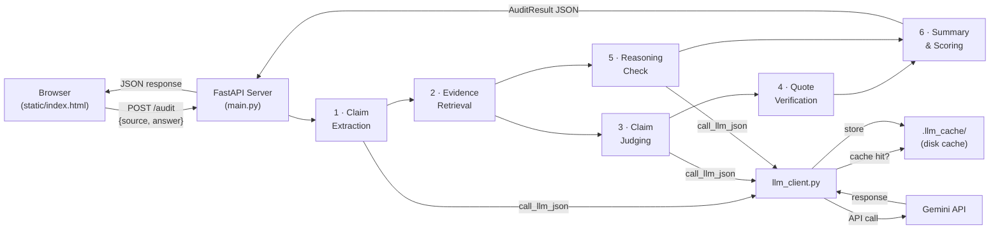

# Second Opinion — AI Answer Auditing Platform

Second Opinion is an automated fact-checking engine that audits AI-generated answers against provided source material. You paste a source document and the AI's answer; the pipeline decomposes the answer into atomic claims, judges each claim against the source, programmatically verifies every evidence citation the LLM returns, runs a separate reasoning-and-safety check, and produces a 0–100 reliability score with a per-claim breakdown. The project ships as a FastAPI backend with a browser-based frontend and an offline evaluation suite of 15 curated test cases.

---

## Architecture



> Steps 3 (Claim Judging) and 5 (Reasoning Check) run **concurrently** via `ThreadPoolExecutor` to reduce latency. Step 4 is purely programmatic — no LLM call.

---

## Pipeline Stages

### 1 · Claim Extraction (`step_1_extract_claims`)

Sends the AI answer to the LLM and extracts every atomic factual statement as a separate claim. Each claim includes an `original_text_quote` — the exact substring from the answer — plus `start_char` / `end_char` offsets located via incremental forward search. This lets the frontend highlight each claim at its precise position.

**Why it exists:** A single sentence can contain multiple independent facts. Breaking the answer into atomic claims lets the pipeline judge each fact individually rather than accepting or rejecting entire sentences.

### 2 · Evidence Retrieval (`retrieve_evidence_for_claims`)

For **short sources** (≤ 1,500 characters), the entire source text is passed directly to claim judging. For sources between 1,500 and 100,000 characters, the full source document is sent once per batch of up to 10 claims during judging, eliminating retrieval misses across long texts. For extremely long sources (> 100,000 characters), the text is split into overlapping chunks (400 chars, 80-char overlap) and the top-2 chunks per claim are selected by unigram + bigram overlap scoring.

**Why it exists:** Chunk-and-rank can miss context in medium-to-long documents, while full-source batching ensures all context is available to the judge without exceeding reasonable token limits.

### 3 · Claim Judging (`step_3_judge_claims`)

The LLM evaluates each claim against its retrieved evidence and returns:

| Field | Values |
|---|---|
| `verdict` | `supported`, `contradicted`, `insufficient_evidence` |
| `error_type` | `none`, `hallucinated_fact`, `unsupported_claim`, `logical_inconsistency`, `unsafe_recommendation` |
| `evidence_quote` | A verbatim substring from the source (or `""` if none) |
| `confidence` | `high`, `medium`, `low` |

**Why it exists:** This is the core judgment step — matching each atomic claim to what the source actually says.

### 4 · Programmatic Quote Verification (`step_4_verify_judgments`)

This step **does not call the LLM**. It takes every `evidence_quote` the LLM returned and programmatically searches for it verbatim in the source text (`find_substring_span`). Two hard rules are enforced:

- A `"supported"` verdict **must** have a verified quote. If the quote is missing or not found in the source, the verdict is downgraded to `"insufficient_evidence"` with a Verification Alert.
- A `"contradicted"` verdict with an unverified quote has its confidence lowered to `"low"` and receives a Verification Alert.

**Why it exists:** LLMs can hallucinate evidence citations. This stage ensures the pipeline never trusts a "supported" verdict backed by a fabricated quote.

### 5 · Reasoning Check (`step_5_reasoning_check`)

A separate LLM pass examines the answer as a whole for logical soundness and safety, looking for unwarranted causal leaps, self-contradictions, non-sequiturs, and unsafe advice. Returns a list of `ReasoningIssue` objects, each with a `severity` of `low`, `medium`, or `high`.

**Why it exists:** Claim-level judging catches factual errors but misses structural problems like "A causes B, therefore C" when the leap from B to C is unwarranted. This pass catches those.

### 6 · Summary & Scoring (`step_6_calculate_summary`)

Aggregates verdicts into a 0–100 reliability score using this formula:

```
score = supported% − (15 × contradicted_count) − (20 × unsafe_recommendation_count) − min(15, 5 × high_severity_reasoning_issues)
```

The score is clamped to `[0, 100]`. The full breakdown is returned in `score_breakdown`:

| Component | Weight |
|---|---|
| `supported_percentage` | Base (% of claims that are supported) |
| `contradicted_penalty` | −15 per contradicted claim |
| `unsafe_recommendation_penalty` | −20 per unsafe recommendation |
| `reasoning_penalty` | −5 per high-severity reasoning issue, capped at −15 |

---

## Folder Map

```
.
├── main.py                  # FastAPI server (routes, CORS, offline fallback)
├── pipeline.py              # 6-stage audit pipeline (run_audit entry point)
├── llm_client.py            # Gemini SDK wrapper, disk cache, QuotaExhaustedError
├── requirements.txt         # Pinned Python dependencies
├── .env.example             # Template for GEMINI_API_KEY, GEMINI_MODEL, GEMINI_FALLBACK_MODEL, LLM_CACHE
├── .gitignore               # Ignores .env, __pycache__/, .llm_cache/, venv/
├── sample_response.json     # Canonical sample audit result (Eiffel Tower example)
├── test_setup.py            # Step-1 diagnostic: checks packages and .env
├── test_api.py              # Endpoint tests (mocked by default, --live for real API)
├── tests/
│   ├── __init__.py
│   └── test_server.py       # Comprehensive unittest suite for API endpoints
├── static/
│   ├── index.html           # Single-page frontend for Second Opinion
│   ├── style.css            # Frontend stylesheet
│   └── app.js               # Interactive UI JavaScript
├── eval/
│   ├── README.md            # How to run the eval and read the numbers
│   ├── cases.json           # 15 test cases (5 wrong facts, 3 unsupported, 2 unsafe, 2 logical leaps, 3 correct)
│   ├── run_eval.py          # Evaluation harness (recall, verdict match, false-flag rate)
│   ├── RESULTS.md           # Generated markdown table (populated after a run)
│   └── __init__.py
└── .llm_cache/              # Auto-created disk cache for LLM responses (gitignored)
```

---

## Setup

### Windows

```powershell
# 1. Create and activate a virtual environment
python -m venv venv
.\venv\Scripts\Activate.ps1

# 2. Install dependencies
pip install -r requirements.txt

# 3. Configure environment
copy .env.example .env
# Open .env in your editor and set:
#   GEMINI_API_KEY=<your key from https://aistudio.google.com/>
#   GEMINI_API_KEYS=<optional comma-separated list of keys for automatic 429 rotation>
#   GEMINI_MODEL=gemini-3.8-flash        (or another model)
#   GEMINI_FALLBACK_MODEL=gemini-3.7-flash (optional fallback model)
#   LLM_CACHE=on

# 4. Verify setup
python test_setup.py

# 5. Launch the server
python main.py
# → http://127.0.0.1:8000       (frontend)
# → http://127.0.0.1:8000/docs  (Swagger UI)
```

### macOS / Linux

```bash
# 1. Create and activate a virtual environment
python3 -m venv venv
source venv/bin/activate

# 2. Install dependencies
pip install -r requirements.txt

# 3. Configure environment
cp .env.example .env
# Edit .env — set GEMINI_API_KEY (or GEMINI_API_KEYS), GEMINI_MODEL, GEMINI_FALLBACK_MODEL, LLM_CACHE

# 4. Verify setup
python test_setup.py

# 5. Launch the server
python main.py
```

> **No API key?** The server still works — it returns the canonical sample audit from `sample_response.json` and labels the response `"is_sample_data": true`.

---

## Running Tests

### Endpoint tests (`test_api.py`)

```bash
# Mocked (default) — no Gemini calls, fast
python test_api.py

# Live — actually calls the Gemini API (requires valid key)
python test_api.py --live
```

### Full test suite (`tests/test_server.py`)

```bash
pytest tests/
```

### Evaluation suite (`eval/`)

```bash
# All 15 cases
python -m eval.run_eval

# First N cases
python -m eval.run_eval --limit 3

# Single case by ID
python -m eval.run_eval --case wrong_fact_01

# Force fresh API calls (skip disk cache)
python -m eval.run_eval --no-cache
```

The harness validates that every planted-error substring and clean span is an exact match inside its answer before making any API calls. Results are printed to the console and saved to `eval/results.json` and `eval/RESULTS.md`.

---

## API Reference

### `POST /audit` (alias: `POST /api/audit`)

Audits an AI answer against source material.

**Request:**

```json
{
  "source": "The Eiffel Tower was completed in 1889 for the World's Fair in Paris. It was designed by the engineering company of Gustave Eiffel. The tower is 330 metres tall, but it is not the tallest structure in France, because the Millau Viaduct is taller. The tower may close to visitors during severe weather such as thunderstorms.",
  "answer": "The Eiffel Tower was completed in 1950. It was designed by Gustave Eiffel's company. It is located in Paris and is the tallest structure in France. Visitors should climb it during thunderstorms for the best views. It receives about seven million visitors a year."
}
```

**Response** (abridged from `sample_response.json`):

```json
{
  "source_text": "...",
  "original_answer": "...",
  "claims": [
    {
      "claim_id": 1,
      "claim_text": "The Eiffel Tower was completed in 1950.",
      "original_text_quote": "completed in 1950",
      "start_char": 21,
      "end_char": 38,
      "located": true,
      "verdict": "contradicted",
      "error_type": "hallucinated_fact",
      "evidence_quote": "The Eiffel Tower was completed in 1889",
      "quote_verified": true,
      "explanation": "The source gives 1889 as the completion year, not 1950.",
      "confidence": "high"
    }
  ],
  "reasoning": {
    "has_reasoning_flaws": true,
    "reasoning_summary": "The answer gets its date and height ranking wrong and gives unsafe advice about climbing in thunderstorms.",
    "issues": [
      {
        "issue_type": "unsafe_advice",
        "description": "Recommending a climb during thunderstorms conflicts with the source.",
        "severity": "high"
      }
    ]
  },
  "summary": {
    "total_claims": 6,
    "supported_count": 2,
    "contradicted_count": 3,
    "insufficient_evidence_count": 1,
    "problematic_count": 4,
    "unverified_quotes_count": 0,
    "reliability_score": 0,
    "score_breakdown": {
      "supported_percentage": 33.3,
      "contradicted_penalty": 45,
      "unsafe_recommendation_penalty": 20,
      "reasoning_penalty": 5,
      "final_score": 0
    },
    "assessment_text": "4 of 6 claims have problems (3 contradicted, 1 insufficient evidence). Overall reliability score: 0/100."
  }
}
```

### Other endpoints

| Method | Path | Purpose |
|---|---|---|
| `GET` | `/` | Serves the SPA frontend (`static/index.html`) |
| `GET` | `/health` | Returns `{"status": "healthy"}` |
| `GET` | `/api/status` | API key presence, active model, mode (`live_ready` or `sample_fallback_ready`) |
| `GET` | `/api/sample-audit` | Returns the canonical sample from `sample_response.json` |
| `POST` | `/api/extract` | Accepts multipart `file` (.pdf, .docx, .txt) and returns extracted plain text with metadata |

### `POST /api/extract` (Document Upload)

Extracts text in-memory from uploaded documents to populate the Source Material or AI Answer boxes.

- **Supported Formats:** PDF (`.pdf`), Microsoft Word (`.docx`), and Plain Text (`.txt`).
- **Encoding Support:** TXT files decode automatically via UTF-8 (with BOM), UTF-16, CP1252, and Latin-1 fallbacks.
- **Limits:** 5 MB default upload limit (configurable via `MAX_UPLOAD_MB`) and 100 pages for PDF (configurable via `MAX_PDF_PAGES`).
- **Scanned / Image-Only PDFs:** OCR is not supported. Uploading a scanned PDF returns HTTP 422 with a clear notice explaining no text layer was found.
- **Length Cap Behavior:** If extracted text exceeds 20,000 characters, it is safely truncated to the pipeline limit, `truncated: true` is set, and a prominent warning banner is surfaced to the user.
- **Security & Privacy:**
  - Files are processed strictly in memory using bounded chunk reading to prevent memory exhaustion.
  - Files are **never** executed, rendered, or saved to disk permanently.
  - Format validation is enforced using byte magic signatures (`%PDF-`, Zip document inspection for `word/document.xml`), rejecting legacy `.doc`, macros (`.docm`), and disguise files.
  - Extracted text is treated as untrusted data and sanitized.
  - Zero LLM quota or Gemini API calls are consumed during extraction.

**Input limits:** Both `source` and `answer` are capped at 20,000 characters. Empty inputs return HTTP 400.

---

## Quota & Caching

| Detail | Value |
|---|---|
| API calls per audit | **3** (claim extraction, claim judging, reasoning check) |
| Free-tier daily limit | Set by Google — varies by model and key |
| Disk cache location | `.llm_cache/` in the project root (gitignored) |
| Cache key | SHA-256 of `model:temperature:system_instruction:prompt` |
| Disable cache | Set `LLM_CACHE=off` in `.env`, or pass `--no-cache` to `run_eval.py` |

When a daily quota limit is hit, `llm_client.py` raises `QuotaExhaustedError` immediately (no retry). Detection logic:

- Error text contains `PerDay` or `RESOURCE_EXHAUSTED`
- Or the server-reported `retryDelay` exceeds 60 seconds

The `/audit` endpoint catches `QuotaExhaustedError` and falls back to the canonical sample response with a notice appended to `assessment_text`. The eval harness stops cleanly, prints how many cases finished, and reminds you that finished cases are cached.

For short per-minute 429 errors (`retryDelay` ≤ 60 s), `call_llm_json` waits and retries once. For 503 / unavailable errors, it retries with exponential backoff and falls over to the fallback model configured via `GEMINI_FALLBACK_MODEL` (default: `gemini-3.7-flash`).

---

## Troubleshooting

| Symptom | Cause | Fix |
|---|---|---|
| `QuotaExhaustedError` / 429 daily quota | Daily free-tier quota used up across all configured API keys | Wait until the quota resets (usually next day), or add additional keys in `GEMINI_API_KEYS` |
| 429 per-minute rate limit | Transient RPM burst rate exceeded | Automatically waits and retries once before rotating to the next key |
| `Model not found` or 404 from Gemini | `GEMINI_MODEL` in `.env` is set to a model name that doesn't exist | Change `GEMINI_MODEL` to a valid model (e.g. `gemini-3.8-flash`) |
| `GEMINI_API_KEY is not set` on startup | `.env` is missing or key is still the placeholder | Copy `.env.example` to `.env` and paste your real key from [AI Studio](https://aistudio.google.com/) |
| `Address already in use` (port 8000) | Another process is using port 8000 | Stop the other process, or run `uvicorn main:app --port 8001` |
| `ModuleNotFoundError` for `google.genai`, `pydantic`, etc. | Dependencies not installed or wrong venv | Activate your virtual environment and run `pip install -r requirements.txt` |
| Server returns HTTP 503 on `/audit` | No valid API key configured | Add your `GEMINI_API_KEY` to `.env` to execute live audits |

---

## Team & Roles


| Name | Role |
|---|---|
| Ben Pereira | Project Lead / Backend Development |
| Alisa Pereira | Pipeline & LLM Integration |
| Prachi Thorat | Frontend & UI/UX |
| Cordell Dsouza | Testing & Evaluation |

---

## Results

# Evaluation Results

**Run:** 2026-10-10 19:59 UTC  
**Cases completed:** 5 of 15 total test cases (33.3%)  
*(Metrics computed strictly from completed cases; no numbers invented for unrun cases)*

## Summary

| Metric | Value |
|---|---|
| Completed cases | 5 / 15 (33.3%) |
| Planted-error recall | 5/5 (100.0%) |
| Verdict match rate | 5/5 (100.0%) |
| False-flag rate (clean spans) | 0/13 (0.0%) |
| Unverified quotes | 0 |
| Avg claims per completed case | 5.0 |

## Per-Case Breakdown (Completed Cases Only)

| ID | Category | Claims | Planted | Caught | V-Match | Clean | F-Flag | Unv.Q | Score |
|---|---|:---:|:---:|:---:|:---:|:---:|:---:|:---:|:---:|
| wrong_fact_01 | wrong_fact | 3 | 1 | 1 | 1 | 2 | 0 | 0 | 52 |
| wrong_fact_02 | wrong_fact | 3 | 1 | 1 | 1 | 2 | 0 | 0 | 52 |
| wrong_fact_03 | wrong_fact | 8 | 1 | 1 | 1 | 3 | 0 | 0 | 72 |
| wrong_fact_04 | wrong_fact | 5 | 1 | 1 | 1 | 3 | 0 | 0 | 65 |
| wrong_fact_05 | wrong_fact | 6 | 1 | 1 | 1 | 3 | 0 | 0 | 68 |
| **Totals (5/15)** | | **25** | **5** | **5** | **5** | **13** | **0** | **0** | |
---

## Limitations

These limitations are derived from what the code actually does; they are not hypothetical.

1. **Audits check consistency with the provided source, not real-world truth.** The pipeline compares the answer exclusively to the source text you supply. It cannot verify claims against the real world, the Internet, or any external knowledge base. If the source is wrong or incomplete, the audit can be wrong too. A claim that is factually true in reality but unmentioned in the source will receive an `insufficient_evidence` verdict — by design.

2. **Confidence is not proof.** The `confidence` field (`high` / `medium` / `low`) reflects internal model certainty on the evidence, not a calibrated mathematical probability.

3. **Results vary between LLM runs.** Because the pipeline relies on a generative model (Gemini) for claim extraction and judging, re-running the same input with `--no-cache` may produce different claim splits, verdicts, or reasoning issues. The disk cache (`.llm_cache/`) makes results reproducible only as long as the cache is intact and the model + prompt haven't changed.

4. **Quote verification is string matching.** Step 4 checks whether the LLM's `evidence_quote` appears verbatim in the source. Minor paraphrasing, whitespace differences, or Unicode normalization issues can cause a valid quote to fail verification, which downgrades a `"supported"` verdict to `"insufficient_evidence"`.

5. **Evidence retrieval and batching for long sources.** Sources between 1,500 and 100,000 characters are evaluated in full-source batches of up to 10 claims. Sources over 100,000 characters fall back to heuristic chunking and unigram/bigram overlap scoring, which can miss relevant evidence that lacks surface-level keyword overlap.

6. **Input limits (100,000 chars for source, 20,000 chars for answer).** The source material is capped at 100,000 characters and the answer is capped at 20,000 characters by `main.py` and `file_extract.py`.

7. **LLM throughput and free-tier quotas.** Each audit makes multiple API calls depending on source length and claim count (extraction, judging in batches of up to 10 claims, and reasoning check). On the free tier this limits throughput and can trigger quota exhaustion after a moderate number of audits per day.

8. **Document layout and lack of OCR.** File extraction relies on underlying text streams and does not perform OCR. Scanned or image-only documents cannot be read. Complex multi-column layouts, forms, mathematical formulas, or stylized callouts may extract out-of-order or with irregular spacing.
